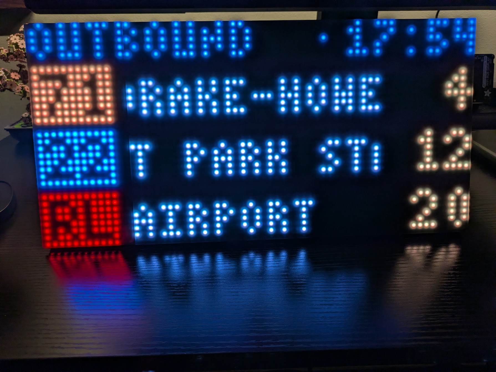

# gcrta-board
`A real-time LED transit arrival board for Clevelanders`

Live GCRTA bus and rail arrivals on a 64x32 LED matrix, driven by an
[Adafruit Matrix Portal M4](https://www.adafruit.com/product/4745) running CircuitPython 10.
It started as a Cleveland version of the [dc-metro](https://github.com/metro-sign/dc-metro) board.



Each row shows a colored route badge, the destination (long names scroll) and the minutes
until the next arrival. Set `TIMES_PER_ROW = 2` to show the next two, like "15,29".
Pages rotate between groups of stops, e.g. inbound and outbound.

Arrival data is provided by the Greater Cleveland Regional Transit Authority (GCRTA)
through [Swiftly](https://www.goswift.ly/), its real-time data provider, under GCRTA's
[developer license](https://www.riderta.com/developers). This project is not affiliated
with or endorsed by GCRTA.

The board asks for one stop at a time, and each request returns a few KB of JSON.

CircuitPython is a friendly version of Python for small devices, made by
[Adafruit](https://www.adafruit.com/), who make and sell educational and hobby electronics,
publish great guides, and are a woman-owned business in NYC. Check them out.

## Hardware
- An [Adafruit Matrix Portal M4](https://www.adafruit.com/product/4745), a small computer
  with Wi-Fi that drives the panel
- A **64x32 RGB LED matrix** that works with the Matrix Portal:
  [3 mm](https://www.adafruit.com/product/2279), [4 mm](https://www.adafruit.com/product/2278),
  [5 mm](https://www.adafruit.com/product/2277) or [6 mm](https://www.adafruit.com/product/2276)
  pitch. Smaller pitch means a smaller, sharper board; 6 mm is about 15" x 7.5".
- A **USB-C power supply** (a 15 W phone charger is plenty for this display) and cable

## Setup
1. [Prepare the Matrix Portal and panel](https://learn.adafruit.com/adafruit-matrixportal-m4/prep-the-matrixportal)
   with Adafruit's guide.
2. [Install CircuitPython 10.x](https://circuitpython.org/board/matrixportal_m4/).
3. **Update the Wi-Fi chip's firmware to NINA 3.x.** Older firmware (1.7.x) can't make a
   secure connection to the Swiftly server, so every request fails with "ESP32 not
   responding". The board prints its firmware version to the serial console at startup.
   See Adafruit's [ESP32 firmware guide](https://learn.adafruit.com/upgrading-esp32-firmware).
4. Copy everything inside `src/` onto the `CIRCUITPY` drive, including the `lib` folder.
   `src/lib` holds the fonts and the CircuitPython 10 libraries the board needs.
5. Add your Wi-Fi. `settings.toml.example` is a template: on the `CIRCUITPY` drive,
   rename it to `settings.toml`, open it in any text editor and fill in your Wi-Fi:
   ```toml
   CIRCUITPY_WIFI_SSID = "your-network-name"      # your Wi-Fi network name
   CIRCUITPY_WIFI_PASSWORD = "your-wifi-password"
   ```
   - **API key:** already filled in. It's the key GCRTA publishes for public use.
   - **Time zone:** leave `TZ_OFFSET` and `TZ_DST` alone if you're on US Eastern time.

   `settings.toml` stays on your board; don't commit it or share it.

   > **Upgrading from an older version?** It kept Wi-Fi details in `secrets.py`, which is no
   > longer used. Move your network name and password into `settings.toml`, then delete
   > `secrets.py` from the drive. The Adafruit IO account is no longer needed either.
6. Edit the `PAGES` list in `config.py` to use your stops (see below). The board restarts
   whenever you save a file.

The drive should look like this:
```
CIRCUITPY
├── code.py  config.py  transit.py  clock.py  screen.py
├── settings.toml
└── lib/
```

## Choosing stops
Every stop entry needs the **stop number** (printed on the stop sign and shown in the Transit
app) and a **route**. Bus stops serve only one direction, so pick the stop on the side of the
street you board from. Rail stations have a separate stop number for each platform.

To search every GCRTA stop from your computer (Python 3.8+, no packages needed):

```
python tools/find_stops.py lorain 117              # stops whose name contains both words
python tools/find_stops.py lorain --route 22       # only stops served by route 22
python tools/find_stops.py 7694 --live             # live arrivals at stop 7694 right now
```

`--live` uses the key from `settings.toml`, so it's a quick way to check a stop before you
put it on the board.

Each page holds any number of entries. The board shows the 3 soonest, and pages rotate
every `PAGE_SECONDS` (longer if a destination needs more time to scroll). Optional
per-entry keys are `label` (badge text), `color` (badge color), `min_minutes` (hide buses
you can't make in time) and `headsign` (only count trips whose destination contains this
text). All the details are in the comments at the top of `config.py`.

Badge colors, text colors and timing are set near the bottom of `config.py`.

## How it behaves
- **Refresh:** each stop is refreshed every `FETCH_SECONDS` (30 s by default), one at a
  time. Requests run in small pieces between scroll steps, so text keeps moving while data
  loads. A small dot left of the clock lights up during a request.
- **Scrolling:** destinations too long for their space pause briefly, then loop
  continuously. A page stays up until its longest destination has gone around once.
- **Countdown:** minutes count down on the board between refreshes.
- **Stale data:** a stop that can't be refreshed for `STALE_SECONDS` drops off rather than
  showing stale times.
- **Messages:** `NO DATA` means nothing has loaded yet. `NONE SOON` means data loaded but no
  arrivals passed the cutoffs.
- **Clock:** set from NTP through the Wi-Fi chip, with the Swiftly server time as a fallback.
  US daylight saving time is handled automatically.
- **Recovery:** after repeated failures the board resets Wi-Fi. If no data arrives for
  10 minutes, it soft-reloads.
- **Debugging:** with `DEBUG = True`, the serial console shows each request's time, the
  free memory and how smoothly text is scrolling.

## Files
| File | Purpose |
|---|---|
| `src/code.py` | Startup, Wi-Fi, main loop |
| `src/config.py` | Your stops and display options |
| `src/transit.py` | Fetches and filters Swiftly predictions |
| `src/screen.py` | LED matrix layout |
| `src/clock.py` | Time sync and time zone |
| `src/settings.toml.example` | Template for Wi-Fi and API key (your copy stays private) |
| `src/lib/` | Fonts and CircuitPython 10 libraries |
| `tools/find_stops.py` | Stop finder, runs on your computer |
| `tools/preview.py` | For developers changing `screen.py`: draws the screen to a PNG on your computer |
